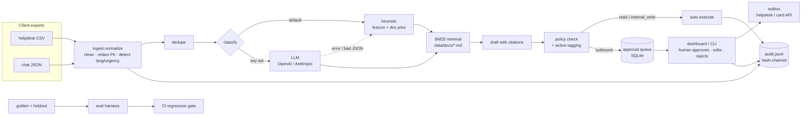

# fde-triage-demo

**Agentic support triage, deployed for a client in a day.** A worked Forward Deployed Engineer
engagement for *Kestrel*, a fictional consumer payments app. All data is synthetic.

## The problem

Kestrel's support team works one FIFO queue. A customer whose account was just taken over waits
behind someone asking about savings interest. From their own helpdesk and chat exports
(159 tickets, Sept–Oct 2026, synthetic), sorted by the priority each ticket *should* have had:

| Priority | Tickets | Median first response | Target | Over target |
|---|---|---|---|---|
| P1: money leaving now / account takeover | 10 | **324 min** | 15 min | 100% |
| P2: money or access stuck | 38 | **417 min** | 60 min | 100% |
| P3: broken, nothing at risk | 48 | 509 min | 240 min | 87.5% |
| P4: questions, fees | 53 | 624 min | 480 min | 64.2% |

**The metric this moves is time to first response on P1/P2 tickets.** The service routes every
ticket to the owning team at the right priority, pages on-call for P1, and puts a cited, policy-checked
draft in front of a human, all within ~1 ms of the ticket arriving. The human approves, edits or
rejects. Nothing customer-facing goes out without that approval.

What this repo shows and what it doesn't: routing quality, grounding, PII safety and the approval
gate are measured below on labelled data. The *real* first-response number only exists once agents
use it, which is why week 1 (below) runs it in shadow mode before anything else.

## What it does

1. **Ingest and normalise** two exports with different schemas (helpdesk CSV, chat JSON): mixed date
   formats, HTML, signatures, quoted replies, five languages. Emails, phone numbers and Luhn-valid card
   numbers are redacted *first*; customers become salted hashes. Near-duplicates from the same customer
   are merged with every source id kept.
2. **Classify and route** to 8 categories, 8 teams, P1–P4. Offline by default: a client-reviewable
   phrase lexicon blended with a retrieval prior over the client's own help docs. Set `OPENAI_API_KEY`
   or `ANTHROPIC_API_KEY` and it uses an LLM instead, falling back to the offline path on any error or
   out-of-schema answer. Low-confidence tickets go to a human triage queue instead of guessing.
3. **Draft grounded replies** from the 9 help-centre articles (BM25 over sections, with numbered
   citations and source URLs). The offline drafter is extractive: it can only say what the docs say.
4. **Gate actions by risk.** Every proposed action is tagged `read` (auto), `internal_write`
   (auto, audited: assign, note, page on-call) or `outbound` (needs approval: send reply, freeze card).
   Drafts are checked against the client's reply policy: no asking for PINs/codes, no refund promises,
   no internal team names, must cite, no PII. Human edits are re-checked before sending.
5. **Audit everything** to an append-only JSONL log where each line carries the hash of the previous
   one, so tampering is detectable (`triage audit --verify`).
6. **Evaluate** on a 40-ticket golden set and a 20-ticket holdout, with a regression gate in CI.
7. **Ship** as a FastAPI service with a one-page dashboard (queue, draft review, metrics, audit trail),
   via `make demo` or `docker compose up`.

## Architecture



## 60-second quickstart

```bash
git clone https://github.com/realmpastai-web/fde-triage-demo && cd fde-triage-demo
make demo                   # install, triage the export, run evals, serve on :8000
# or: docker compose up --build
```

Open <http://127.0.0.1:8000>: the queue is sorted P1 first; click a ticket to see the redacted
message, why it was routed there, the cited draft and the proposed actions; approve or reject.

The same thing from the CLI:

```bash
python -m triage run --reset                 # ingest + triage -> queue
python -m triage queue --limit 5
python -m triage show T-9c5c2250             # draft, citations, actions
python -m triage approve T-9c5c2250 --reviewer priya
python -m triage audit --verify              # OK: 922 entries, ok
make check                                   # lint, mypy --strict, 36 tests, eval gate
```

No API key needed. To try the LLM path: `export OPENAI_API_KEY=...` (or `ANTHROPIC_API_KEY`),
optionally `TRIAGE_LLM=openai|anthropic|off`.

## Eval results

Real output of `python -m triage eval --gate evals/thresholds.json` on the committed data
(offline heuristic, Python 3.12, `reports/eval_report.md`):

| Metric | Golden (n=40) | Holdout (n=20) |
|---|---|---|
| Category accuracy | 100.0% | 75.0% |
| Team routing accuracy | 100.0% | 75.0% |
| Priority exact | 100.0% | 65.0% |
| Priority within one level | 100.0% | 95.0% |
| P1 recall | 100.0% | **0.0%** (0 of 2) |
| Under-prioritised tickets | 0 | 7 |
| Flagged low-confidence → human triage | 0 | 10 |
| Misroutes caught by that flag | 0/0 | **5/5** |
| Drafts with ≥1 citation | 100.0% | 100.0% |
| Expected help article cited | 92.5% | 75.0% |
| Expected article is first citation | 85.0% | 75.0% |
| Policy-clean drafts | 100.0% | 100.0% |

| PII check | PII values | Leaks |
|---|---|---|
| Injected email + phone + card into every golden ticket | 123 | **0** |
| Full client export (159 raw tickets, incl. customer emails and signatures) | 235 | **0** |

Latency per ticket: p50 1.08 ms, p95 1.21 ms. Cost per ticket: $0 offline.
The LLM path records real token cost per ticket; the gate caps it at $0.002.

Tests: `36 passed` (`pytest -q`). Lint, `ruff format --check` and `mypy --strict` clean.

**How to read this.** The golden set is what I tuned the lexicon against, so 100% there mostly proves
the lexicon matches its own examples. The holdout was written afterwards in different words and never
used to edit the lexicon (I looked at it once, which is why the retrieval prior exists; see trade-offs).
**75% on unseen phrasing is the honest number for the offline path.** Two things make it usable anyway:
every one of the 5 holdout misroutes was flagged low-confidence and sent to human triage rather than
to the wrong specialist team, and nothing goes out without approval. The number I'd fix first is
**P1 recall on holdout**: both P1s ("three small payments to a game I've never heard of", a
"move your savings to a safe account" call) were caught as fraud but landed at P2. That is a
lexicon gap on the most expensive failure mode, and it's exactly what the LLM path and the
week-1 shadow run are for.

## How I'd deploy this at a real client in week 1

**Day 1: discovery.** Sit with two support agents and the support lead for half a day each. Pull a
real 90-day export. Agree the category list, team owners and priority definitions in writing (this
repo's `routing-policy.md` is that artefact) and the one metric we're moving: P1/P2 first-response
time, baseline taken from their own data. Get the reply policy from compliance, not from support.

**Day 2: integration.** Read-only connection to the helpdesk API (webhook on ticket created, polling
fallback). Redaction runs inside their VPC before any model call. Map their export schema in
`ingest.py`; everything after that is unchanged. Model choice is theirs: their Azure OpenAI or
Bedrock tenancy, or offline only. SSO in front of the dashboard; reviewer identity comes from the
SSO header.

**Day 3: evals.** Have two agents label 200 real tickets independently; measure their agreement
first, because that is the ceiling. Split into golden (tune) and holdout (never touch). Add every
policy rule as a test. Set gate thresholds with the support lead, starting with zero PII leaks and
P1 recall.

**Days 4–5: rollout.** Shadow mode: triage and draft every live ticket, show nothing to customers,
compare our routing against what agents actually did and log time-to-reviewable-draft. Daily 15-minute
review of misses with the support lead; each miss becomes a lexicon line, a label fix or a golden case.
Go/no-go for week 2 on: holdout routing ≥ the agents' own agreement rate, P1 recall 100%, zero PII
leaks, agents say the drafts save them time. Week 2 turns on routing for real (internal writes only),
week 3 drafts-with-approval for P3/P4 first, P1/P2 last.

## Trade-offs I made

- **Heuristics before models.** The default classifier is a phrase lexicon the client can read and
  edit, plus a BM25 prior over their own docs. It's deterministic, free, works with no network and
  makes CI meaningful. It also tops out around 75% on new phrasing. The LLM path is one env var away
  and shares the same eval and gate, so the comparison is a number, not an opinion.
- **I looked at the holdout once.** After the first holdout run (55%) I added the retrieval prior
  (holdout went to 75%) and picked the smallest prior weight that kept golden at 100%. No lexicon edits
  after that. A purer setup would have a third, untouched test set; with 60 labels that felt like
  theatre. With real data it's the first thing I'd add.
- **BM25, not embeddings.** 43 doc sections. BM25 is explainable ("these words matched"), needs no
  vector store and handled 5 languages well enough with a 50-word glossary. Embeddings are the
  obvious swap once the doc set or language mix grows; the `Retriever` interface stays.
- **Extractive drafts by default.** Stitching sentences from the docs reads stiffer than a model, but
  it can't invent a policy. The LLM drafter must cite, and goes through the same policy check.
  Non-English tickets get an English draft with a "translate before sending" banner rather than
  machine translation nobody has reviewed.
- **Redaction is regex, not NER.** Emails, phones and Luhn-valid cards are covered and tested on 358
  values. Names and street addresses are not; signatures are stripped, but a name in the body will
  survive. For production I'd add an NER pass (e.g. Presidio) in the same place and keep the leak eval.
- **SQLite and a JSONL file.** The right size for one team and a demo. The hash chain makes the audit
  log tamper-evident, not tamper-proof; in production it also ships to their SIEM or WORM storage.
- **Approval is per ticket, not per action.** One click approves all of a ticket's outbound actions
  (reply + card freeze). Simpler for agents; per-action approval is a small change if compliance wants it.
- **Not built:** auth (expected behind SSO), real helpdesk/card-processor calls (outbound actions go to
  `var/outbox.jsonl`), multi-turn conversation threading, SLA timers, and a live-model eval run in CI.

## Repo layout

```
src/triage/        the service (see AGENTS.md for a module map)
data/raw/          synthetic helpdesk CSV + chat JSON export
data/docs/         9 help-centre articles (retrieval corpus)
data/policies/     routing + reply policy agreed in discovery
data/golden/       golden.jsonl (40) and holdout.jsonl (20)
evals/             thresholds.json (the CI regression gate)
scripts/           deterministic generators for all of data/
tests/             36 pytest tests
reports/           latest eval report
```

Regenerate all data with `make data` (seeded, deterministic). Emails use `example.com`/`.org`,
phones use ranges reserved for fiction, cards are public test numbers.

## Working on it

See [AGENTS.md](AGENTS.md): bounded tasks, test or golden case first, eval diff in every PR, no
secrets, nothing outbound without approval.

---

Santhosh Madhava · [github.com/realmpastai-web](https://github.com/realmpastai-web) · MIT licence
