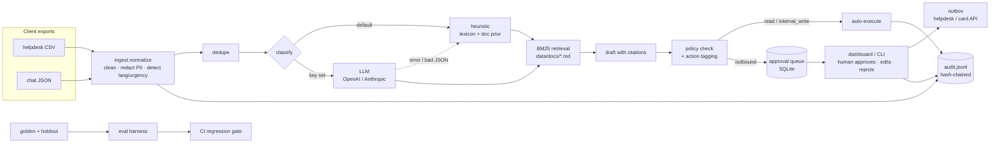

# fde-triage-demo

**Agentic support triage, deployed for a client in a day.** A worked Forward Deployed Engineer
engagement for *Kestrel*, a fictional consumer payments app. All data is synthetic.

## The problem

Kestrel's support team works one FIFO queue. A customer whose account was just taken over waits
behind someone asking about savings interest. From their own helpdesk and chat exports
(159 tickets, Sept–Oct 2026, synthetic), sorted by the priority each ticket *should* have had:

| Priority | Tickets | Median first response | Target | Over target |
|---|---|---|---|---|
| P1: money leaving now / account takeover | 13 | **283 min** | 15 min | 100% |
| P2: money or access stuck | 35 | **422 min** | 60 min | 100% |
| P3: broken, nothing at risk | 48 | 509 min | 240 min | 87.5% |
| P4: questions, fees | 53 | 624 min | 480 min | 64.2% |

**The metric this moves is time to first response on P1/P2 tickets.** The service routes every
ticket to the owning team at the right priority, pages on-call for P1, and puts a cited, policy-checked
draft in front of a human, all within ~1 ms of the ticket arriving. The human approves, edits or
rejects. Nothing customer-facing goes out without that approval.

What this repo shows and what it doesn't: routing quality, grounding, PII safety and the approval
gate are measured below on labelled data. The *real* first-response number only exists once agents
use it, which is why week 1 (below) runs it in shadow mode before anything else.

## What it does

1. **Ingest and normalise** two exports with different schemas (helpdesk CSV, chat JSON): mixed date
   formats, HTML, signatures, quoted replies, five languages. Emails, phone numbers and Luhn-valid card
   numbers are redacted *first*; customers become salted hashes. Near-duplicates from the same customer
   are merged with every source id kept.
2. **Classify and route** to 8 categories, 8 teams, P1–P4. Offline by default: a client-reviewable
   phrase lexicon blended with a retrieval prior over the client's own help docs. Set `OPENAI_API_KEY`
   or `ANTHROPIC_API_KEY` and it uses an LLM instead, falling back to the offline path on any error or
   out-of-schema answer. Low-confidence tickets go to a human triage queue instead of guessing.
3. **Draft grounded replies** from the 9 help-centre articles (BM25 over sections, with numbered
   citations and source URLs). The offline drafter is extractive: it can only say what the docs say.
4. **Gate actions by risk.** Every proposed action is tagged `read` (auto), `internal_write`
   (auto, audited: assign, note, page on-call) or `outbound` (needs approval: send reply, freeze card).
   Drafts are checked against the client's reply policy: no asking for PINs/codes, no refund promises,
   no internal team names, must cite, no PII. Human edits are re-checked before sending.
5. **Audit everything** to an append-only JSONL log where each line carries the hash of the previous
   one, so tampering is detectable (`triage audit --verify`).
6. **Evaluate** on a 40-ticket golden set and two holdouts (v1, 20 tickets, now seen; v2, 21 tickets, new),
   with a regression gate in CI that includes P1 recall and P1 over-escalation.
7. **Ship** as a FastAPI service with a one-page dashboard (queue, draft review, metrics, audit trail),
   via `make demo` or `docker compose up`.

## Architecture



## 60-second quickstart

```bash
git clone https://github.com/realmpastai-web/fde-triage-demo && cd fde-triage-demo
make demo                   # install, triage the export, run evals, serve on :8000
# or: docker compose up --build
```

Open <http://127.0.0.1:8000>: the queue is sorted P1 first; click a ticket to see the redacted
message, why it was routed there, the cited draft and the proposed actions; approve or reject.

The same thing from the CLI:

```bash
python -m triage run --reset                 # ingest + triage -> queue
python -m triage queue --limit 5
python -m triage show T-9c5c2250             # draft, citations, actions
python -m triage approve T-9c5c2250 --reviewer priya
python -m triage audit --verify              # OK: 925 entries, ok
make check                                   # lint, mypy --strict, 69 tests, eval gate
```

No API key needed. To try the LLM path: `export OPENAI_API_KEY=...` (or `ANTHROPIC_API_KEY`),
optionally `TRIAGE_LLM=openai|anthropic|off`.

## Eval results

Real output of `python -m triage eval --gate evals/thresholds.json` on the committed data
(offline heuristic, Python 3.12, `reports/eval_report.md`):

| Metric | Golden (n=40) | Holdout v1, seen (n=20) | Holdout v2, new (n=21) |
|---|---|---|---|
| Category accuracy | 100.0% | 75.0% | 85.7% |
| Team routing accuracy | 100.0% | 75.0% | 85.7% |
| Priority exact | 100.0% | 75.0% | 85.7% |
| Priority within one level | 100.0% | 95.0% | 90.5% |
| P1 recall | 100.0% (5/5) | **100.0% (2/2)**, was 0/2 | **100.0% (7/7)** |
| P1 precision | 100.0% | 100.0% | 100.0% |
| P1 over-escalation (non-P1 paged as P1) | 0 of 35 | 0 of 18 | 0 of 14 |
| Under-prioritised tickets | 0 | 5 | 3 |
| Flagged low-confidence → human triage | 0 | 9 | 3 |
| Misroutes caught by that flag | 0/0 | 5/5 | 2/3 |
| Drafts with ≥1 citation | 100.0% | 100.0% | 100.0% |
| Expected help article cited | 92.5% | 75.0% | 66.7% |
| Expected article is first citation | 85.0% | 75.0% | 57.1% |
| Policy-clean drafts | 100.0% | 100.0% | 100.0% |

| PII check | PII values | Leaks |
|---|---|---|
| Injected email + phone + card into every golden ticket | 123 | **0** |
| Full client export (159 raw tickets, incl. customer emails and signatures) | 235 | **0** |

Latency per ticket: p50 1.1 ms, p95 1.25 ms. Cost per ticket: $0 offline.
The LLM path records real token cost per ticket; the gate caps it at $0.002.

Tests: `69 passed` (`pytest -q`). Lint, `ruff format --check` and `mypy --strict` clean. Gate: 20 checks.

**The P1 fix.** Both v1 P1s were caught as fraud but ranked P2, because P1 depended on a list of
exact phrases. I wrote the missing rule into `routing-policy.md` as the client's policy (money moved
without consent, someone else in the account, codes or credentials handed over, or an impersonation
scam in progress → P1, with a deliberate bias toward over-ranking fraud) and implemented it in
`escalation.py` as combinations of signal families (e.g. *non-consent* AND *money moved*), with
explicit vetoes for the near misses the policy keeps at P2/P3: a charge the customer thinks may be
theirs, a phishing attempt they ignored, a login that was them, merchant and fee disputes, a
declined attempt. It runs regardless of category, and as a floor on the LLM path too.

**Why holdout v2 exists.** Fixing v1 meant looking at it, so v1 is now a regression set, not a test.
v2 (7 P1s, 6 fraud lookalikes that must stay below P1, 8 ordinary tickets in 4 languages) was
committed *before* the fix ran against it, with its gate floors pre-registered. First run: P1 recall
7/7 and no false P1s, but category/team accuracy only **52.4%**: every P1 was paged to the card,
access or general team, and because P1s skip the low-confidence queue nothing caught it. The policy
already says these belong to Fraud & Risk, so P1-rule tickets are now routed there (85.7%). That is
the one change made after seeing v2, so v2 is "seen once" for routing; its P1 numbers are first-run.

**How to read this.** Golden is what the lexicon was tuned on, so 100% there mostly proves it matches
its own examples. **75–86% on unseen phrasing is the honest number for the offline path.** Two things
make it usable anyway: misroutes below P1 mostly get flagged low-confidence and go to human triage
(5/5 on v1, 2/3 on v2), and nothing goes out without approval. Caveat on v2: I wrote both the rule
and v2 in the same session, so it is fresh to the code but not blind to its author. The real test is
200 agent-labelled tickets in week 1.

**What I'd fix first, now.** (1) v2's missed fraud lookalike: "my balance seems about 50 short… probably
my mistake" landed at general/P4, two levels under its P2 label; it was flagged for a human, but a
fraud-adjacent ticket should never sit at P4. (2) Grounding on v2: the expected article was cited for
only 66.7% (the gate floor applies to golden only), mostly where the category was wrong. (3) Lexicon
gaps on "wages" and a merchant "damage fee". All three go to the support lead as lexicon/label review,
not as edits made against the holdout.

## How I'd deploy this at a real client in week 1

**Day 1: discovery.** Sit with two support agents and the support lead for half a day each. Pull a
real 90-day export. Agree the category list, team owners and priority definitions in writing (this
repo's `routing-policy.md` is that artefact) and the one metric we're moving: P1/P2 first-response
time, baseline taken from their own data. Get the reply policy from compliance, not from support.

**Day 2: integration.** Read-only connection to the helpdesk API (webhook on ticket created, polling
fallback). Redaction runs inside their VPC before any model call. Map their export schema in
`ingest.py`; everything after that is unchanged. Model choice is theirs: their Azure OpenAI or
Bedrock tenancy, or offline only. SSO in front of the dashboard; reviewer identity comes from the
SSO header.

**Day 3: evals.** Have two agents label 200 real tickets independently; measure their agreement
first, because that is the ceiling. Split into golden (tune) and holdout (never touch). Add every
policy rule as a test. Set gate thresholds with the support lead, starting with zero PII leaks and
P1 recall.

**Days 4–5: rollout.** Shadow mode: triage and draft every live ticket, show nothing to customers,
compare our routing against what agents actually did and log time-to-reviewable-draft. Daily 15-minute
review of misses with the support lead; each miss becomes a lexicon line, a label fix or a golden case.
Go/no-go for week 2 on: holdout routing ≥ the agents' own agreement rate, P1 recall 100%, zero PII
leaks, agents say the drafts save them time. Week 2 turns on routing for real (internal writes only),
week 3 drafts-with-approval for P3/P4 first, P1/P2 last.

## Trade-offs I made

- **Heuristics before models.** The default classifier is a phrase lexicon the client can read and
  edit, plus a BM25 prior over their own docs. It's deterministic, free, works with no network and
  makes CI meaningful. It also tops out around 75% on new phrasing. The LLM path is one env var away
  and shares the same eval and gate, so the comparison is a number, not an opinion.
- **I looked at holdout v1 twice.** After its first run (55%) I added the retrieval prior (75%), and
  later its 0/2 P1 recall led to the fraud/takeover rule. So v1 is now a regression set (held to 100%
  P1 recall) and v2 was written before the rule touched it. Each time a holdout picks a fix, it is
  retired to "seen" and a new one is written; with real data, agents write it, not me.
- **Over-ranking fraud on purpose.** The P1 rule escalates when a condition *plausibly* holds. It moved
  the client export from 10 to 13 P1s (the 3 new ones: a text pretending to be Kestrel asked for a PIN
  and the customer clicked the link). That is correct under the policy and costs the fraud on-call a
  few pages a week; the gate caps over-escalation at 5% on golden and 10% on each holdout so the bias
  can't drift into paging on every mention of a payment. Regex vetoes ("might be mine", "I hung up")
  are the weak point: unusual wording can slip past either way, which is what the LLM path and shadow
  mode are for.
- **BM25, not embeddings.** 43 doc sections. BM25 is explainable ("these words matched"), needs no
  vector store and handled 5 languages well enough with a 50-word glossary. Embeddings are the
  obvious swap once the doc set or language mix grows; the `Retriever` interface stays.
- **Extractive drafts by default.** Stitching sentences from the docs reads stiffer than a model, but
  it can't invent a policy. The LLM drafter must cite, and goes through the same policy check.
  Non-English tickets get an English draft with a "translate before sending" banner rather than
  machine translation nobody has reviewed.
- **Redaction is regex, not NER.** Emails, phones and Luhn-valid cards are covered and tested on 358
  values. Names and street addresses are not; signatures are stripped, but a name in the body will
  survive. For production I'd add an NER pass (e.g. Presidio) in the same place and keep the leak eval.
- **SQLite and a JSONL file.** The right size for one team and a demo. The hash chain makes the audit
  log tamper-evident, not tamper-proof; in production it also ships to their SIEM or WORM storage.
- **Approval is per ticket, not per action.** One click approves all of a ticket's outbound actions
  (reply + card freeze). Simpler for agents; per-action approval is a small change if compliance wants it.
- **Not built:** auth (expected behind SSO), real helpdesk/card-processor calls (outbound actions go to
  `var/outbox.jsonl`), multi-turn conversation threading, SLA timers, and a live-model eval run in CI.

## Repo layout

```
src/triage/        the service (see AGENTS.md for a module map)
data/raw/          synthetic helpdesk CSV + chat JSON export
data/docs/         9 help-centre articles (retrieval corpus)
data/policies/     routing + reply policy agreed in discovery
data/golden/       golden.jsonl (40), holdout_v1.jsonl (20, seen), holdout_v2.jsonl (21, new)
evals/             thresholds.json (the CI regression gate)
scripts/           deterministic generators for all of data/
tests/             69 pytest tests
reports/           latest eval report
```

Regenerate all data with `make data` (seeded, deterministic). Emails use `example.com`/`.org`,
phones use ranges reserved for fiction, cards are public test numbers.

## Working on it

See [AGENTS.md](AGENTS.md): bounded tasks, test or golden case first, eval diff in every PR, no
secrets, nothing outbound without approval.

---

Santhosh Madhava · [github.com/realmpastai-web](https://github.com/realmpastai-web) · MIT licence
